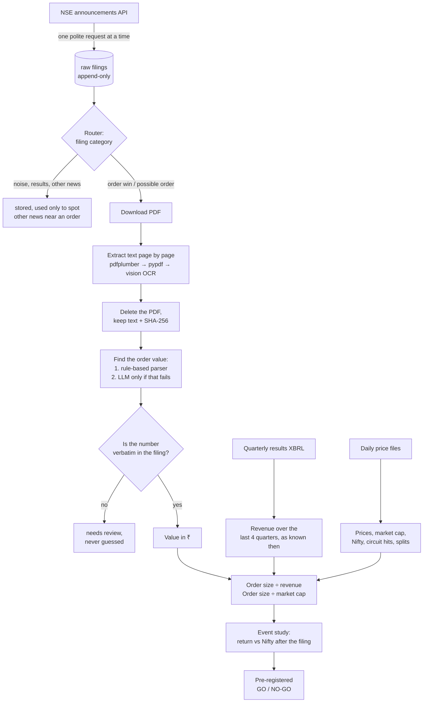

# Reg30 Radar: do NSE order-win announcements move stock prices?

When a listed Indian company wins a large contract, it has to tell the stock exchange.
Hundreds of these "order win" filings appear on NSE every month. A common belief is that
the stock jumps when one comes out, especially when the order is big compared to the
company.

This project tests that belief with data instead of anecdotes. It collects every NSE
corporate announcement, finds the order wins, reads the order value out of each filing's
PDF, compares it with the company's revenue and market value, and measures how the stock
moved afterwards, over 12 months of history.

It is a **personal research project**. It places no trades, contains no broker code, and
nothing here is investment advice.

> **Status (Oct 2026):** the pipeline is built and the 12-month dataset is collected. The
> final verdict (below) is being computed. Results will be published in `RESULTS.md`.

---

## What it does, in one picture



## How it works, step by step

**1. Collect every filing.** The collector polls NSE's corporate-announcements endpoint:
every 60 seconds during market hours, every 3 minutes after the close (most companies
file in the evening, when board meetings end), and every 10 minutes otherwise. Each filing
is stored once, with the exchange's timestamp and the time we first saw it. The raw table
is append-only. If NSE corrects a filing, the correction is stored as a new revision and
the original is never overwritten.

**2. Sort filings by category.** NSE tags each filing with a category ("Bagging/Receiving
of orders/contracts", "Press Release", "Updates", ...). A hand-written map turns each
category into a bucket. Order categories go on to be read. Generic categories such as press
releases are read only if the headline mentions an order, a contract or a letter of award.
Words like "order passed" or "tax assessment" in a headline rule it out. Everything else is
stored and used only as context.

**3. Read the PDF, then delete it.** For each candidate filing the PDF is downloaded,
hashed (SHA-256) and turned into text page by page, with a quality check on every page:

- First the PDF's own text layer is tried (pdfplumber, then pypdf).
- A page that comes out empty, garbled, or in a broken font is rendered to an image and
  transcribed by a vision model.
- Then the PDF is deleted. Only the text, the URL and the hash are kept, so any number can
  be checked against its source later without storing gigabytes of PDFs.

**4. Find the order value, and prove it.** This is the hard part. Filings write values in
many ways: "₹ 13.51 Crs", "INR 65,02,160.50/-", "Rupees Thirteen Crore Fifty One Lakh
only", "USD 18 million", "over ₹5,400 crore", or a size band ("between ₹100 and 200
crore").
- **Code goes first.** A rule-based parser reads the disclosure table SEBI requires, and a
  unit normaliser converts crore, lakh, million and number words into exact rupees. It
  uses decimal arithmetic, never floating point.
- **An LLM is used only when the parser fails.** It is OpenAI's cheapest current model,
  called in batches for the historical data. The model only *quotes* the text it found; it
  never converts units or does maths.
- **Every value must be proven.** The quoted text must appear verbatim in the document and
  must parse to exactly the stored number. A value that can't be proven is marked for
  review, never guessed.
- **Ambiguous forms are flagged, not forced.** A stated minimum ("over ₹X") is kept and
  flagged as a lower bound. A size legend gives no value. A malformed number such as
  "2.917.6 crore" gives no value. A number read by our own OCR needs a second,
  independent read before it counts.

**5. Work out how big the order is.** Revenue comes from each company's quarterly results
(XBRL files), summed over the last four quarters *as they were known on the filing date*,
so the study never uses information from the future. A missing Q4 is derived as full year
minus nine months. Market cap is taken at the last close before the filing. That gives two
ratios: order value ÷ revenue, and order value ÷ market cap.

**6. Measure the price reaction.** For each order win:
- **Day 0** is the filing day if it came before 15:30, otherwise the next trading day.
- **Returns** are measured from the day-0 close to +1, +3, +5 and +10 trading days, minus
  the Nifty 50 over the same days.
- **Excluded from the main test:**
  - events with another material announcement within ±3 days, since that news might be
    what moved the price;
  - events whose window contains a split, bonus or rights issue, because prices aren't
    adjusted for those.
- **Reported separately:** returns for stocks locked at their upper circuit on day 0.
  Such a gain is on paper only, since no one could have bought at that close.

**7. Decide with a rule fixed in advance.** The go/no-go rule was written down *before any
return was computed*, so the result can't be tuned after the fact.

> **Hypothesis:** order wins worth at least 15% of a company's yearly revenue, at companies
> worth ₹500–20,000 crore, beat the Nifty over the 5 trading days after the filing.
>
> **GO only if all four hold:** at least 30 clean events; the median excess return beats a
> 0.75% round-trip trading cost; so does the mean; and the sign is the same in both halves
> of the year.

Every other slice of the data (other sizes, other horizons, contaminated events) is
reported, but labelled exploratory. It can suggest a new hypothesis to test on future data,
but it can never turn this result into a GO.

## What has been measured so far

| | |
|---|---|
| Companies studied (NSE mainboard, market cap ≥ ₹500 cr on 22 Sep 2025) | 1,583 |
| Announcements collected, 22 Sep 2025 – 18 Sep 2026 | 162,251 |
| Days where the API had the filings the exchange's own daily report lists | 96.6% of order-filing companies, over 246 trading days |
| Order-related PDFs read | 2,120 |
| Order values verified against their source text | 1,427 |
| Distinct order events after merging repeat filings | 1,281 |
| Hand-labelled test filings: values the parser would accept that are wrong | 0 of 18 |
| Labelled filings the full pipeline answered | 6 of 6 correct |
| Total LLM cost for the whole 12-month backfill | under $0.60 |
| Automated tests | 467, no network needed |

**How much data the verdict needs.** On 54,081 ordinary "placebo" days, the 5-day
return over Nifty for these stocks has a standard deviation of 5.75% (4.43% if the extreme
tails are discounted). So 30 clean events can only detect an effect of about **2.5%**.
Smaller real effects would show up as "not enough evidence", not as "no effect", and the
results will be reported that way.

## Design choices worth knowing

- **Never guess a number.** If a value can't be extracted *and* verified, it is stored as
  null with a reason. A wrong order value is worse than a missing one.
- **Point-in-time everything.** Revenue, market cap and the list of companies are taken
  as they were known at the time, never as they are today.
- **Cheap by design.** Rule-based code handles about half the filings for free, the LLM
  is only a fallback, historical work goes through OpenAI's half-price Batch API, and hard
  spend caps make work wait in a queue instead of spending more.
- **A polite client.** Only one process talks to NSE at a time, enforced by a lock file.
  Requests are spaced at least 2–3 seconds apart with random jitter, and the client backs
  off on errors. It stops after 5 failures in a row, and stops at once if a response comes
  back in a shape it doesn't recognise. It does no IP rotation, user-agent spoofing or
  CAPTCHA solving.
- **Written down.** Every decision, and the measurement behind it, is in
  [ARCHITECTURE.md](ARCHITECTURE.md). Every dead end and correction is in
  [WORKLOG.md](WORKLOG.md).

## Known limitations

- **Orders hidden in generic filings are partly missed.** Some companies announce orders
  under "Press Release" or "Updates" with a vague headline. For the historical study only
  the filings whose headline points to an order were read. On live data, about one order
  in four was visible only inside the PDF, so the sample leans towards companies that file
  under the proper category.
- **Foreign-currency orders.** US dollar values are converted at a fixed ₹94. Other
  currencies are not converted and go to review.
- **First-seen times have gaps.** The live collector was offline for parts of October 2026.
  Filings recovered afterwards are marked as recovered and are never treated as seen in
  real time.
- **One model.** The independent second read uses the same LLM blind, so it catches
  one-off misreads but not a mistake the model always makes.

## Running it yourself

Needs Python 3.14 and PostgreSQL 16.

```powershell
git clone https://github.com/sravanth-dev/reg30-radar.git
cd reg30-radar
python -m venv .venv
.venv\Scripts\Activate.ps1             # Linux/macOS: source .venv/bin/activate
pip install -e ".[dev]"
copy .env.example .env                 # fill in DATABASE_URL and OPENAI_API_KEY
python -m reg30_radar.common.migrate   # create the tables
python -m pytest -q                    # no network needed
```

Day to day:

```powershell
python -m reg30_radar.catchup   # after any downtime: fetch what was missed
python -m reg30_radar.live      # poll NSE and read new order filings, until stopped
python -m reg30_radar.sheets    # optional: mirror the data into a Google Sheet
python -m reg30_radar.eval      # accuracy on the hand-labelled filings
```

The historical study runs as stages, `python -m reg30_radar.backfill <stage>`, in the order
listed in `backfill/__main__.py`. With Docker:

```powershell
copy .env.docker.example .env.docker
docker compose --env-file .env.docker -f docker-compose.yml -f docker-compose.local-db.yml up -d --build
```

## Repository map

| Folder | What's in it |
|---|---|
| `src/reg30_radar/collector`, `live`, `catchup` | Polling NSE and recovering after downtime |
| `src/reg30_radar/router` | Filing category → bucket |
| `src/reg30_radar/documents` | PDF download, per-page text extraction, OCR, deletion |
| `src/reg30_radar/extractor`, `units` | Finding the order value and proving it; rupee conversion |
| `src/reg30_radar/llm` | The single gateway to the LLM: caps, cost logging, batching |
| `src/reg30_radar/revenue` | Quarterly results XBRL → point-in-time revenue |
| `src/reg30_radar/market` | Daily price, market-cap and circuit-limit files |
| `src/reg30_radar/backfill` | The 12-month run, the event study and the verdict |
| `src/reg30_radar/sheets` | Optional read-only Google Sheets mirror |
| `config/`, `prompts/`, `migrations/` | Settings, versioned LLM prompts, database schema |
| `tests/` | Unit tests, real exchange files, hand-labelled filings |
| `reports/` | Generated reports (power analysis, extraction baselines, results) |

A one-line description of every file is in [FILES.md](FILES.md).

## A note on the data

NSE filings are public disclosures. This project reads them slowly, for personal research,
and redistributes nothing. NSE's `robots.txt` allows this access, but its website terms of
use restrict automated collection. If you run this code, you are responsible for how you
use it. The details are recorded in [ARCHITECTURE.md](ARCHITECTURE.md) §3.
